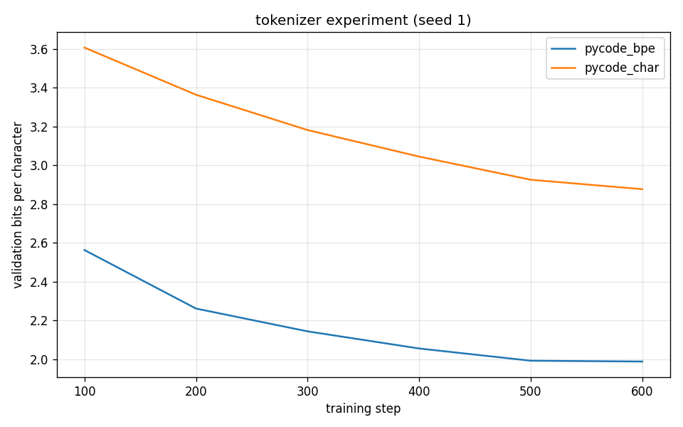
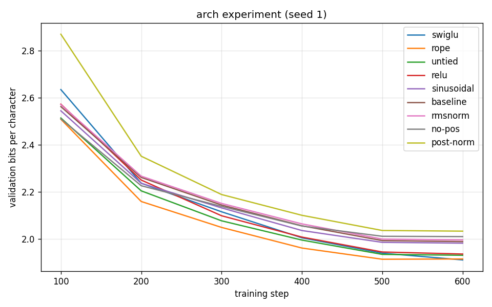
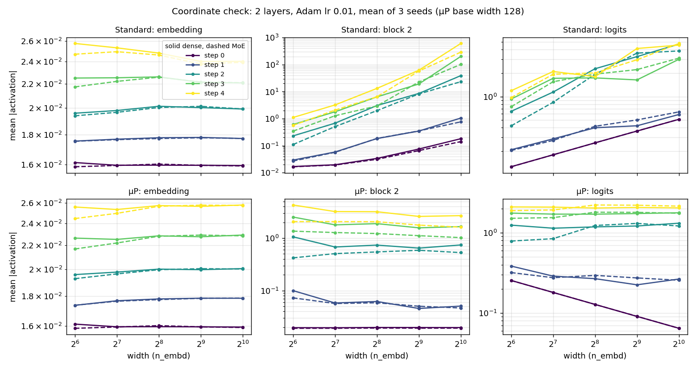
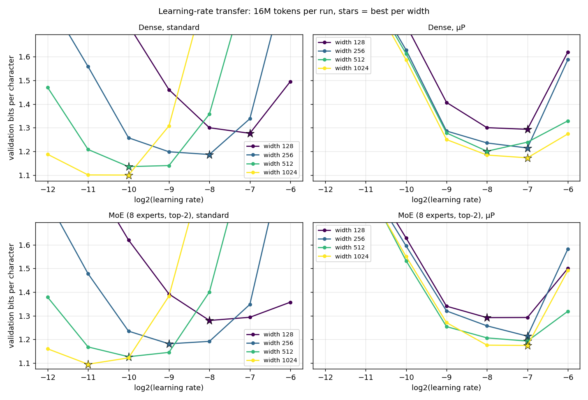
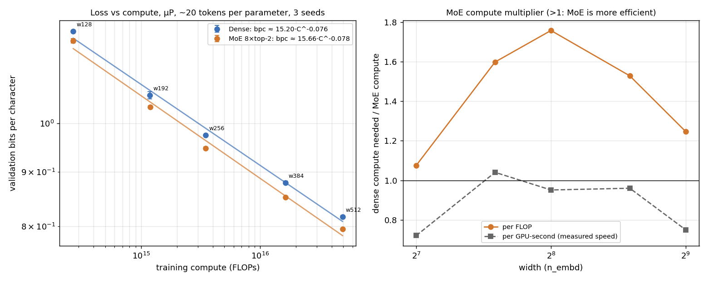

# tinyformer

[](https://github.com/sweeney-007/tinyformer/actions/workflows/tests.yml)
[](https://colab.research.google.com/github/sweeney-007/tinyformer/blob/main/notebooks/train_colab.ipynb)

**A GPT-style transformer and a byte-level BPE tokenizer, built from scratch
in Python and raw PyTorch, plus a small lab for controlled experiments on
what each part contributes, and µP and mixture-of-experts scaling
experiments on cloud GPUs.**

No Hugging Face, no `tiktoken`, no `nn.Transformer`. Attention, masking,
normalization, positional encodings, the tokenizer and sampling are all
written out by hand in about 1,200 lines of commented code, scripts included.

```
text ─► BPE tokenizer ─► token ids ─► [embedding + position]
                                          │
                              ┌───────────▼───────────┐
                              │  N × transformer block │  norm → causal attention → +
                              │                        │  norm → MLP → +
                              └───────────┬───────────┘
                                          ▼
                              norm → linear → next-token probabilities
```

## Why this matters

Training a frontier model costs tens of millions of dollars, so almost every
design decision is made on small models first and then extrapolated:
which tokenizer, which positional encoding, what learning rate, dense or
mixture-of-experts. That only works if the small-scale experiments are
controlled (one change at a time, same data, several seeds) and if their
conclusions carry over to bigger models. tinyformer runs those experiments
at a scale anyone can reproduce, with every line of the model visible, so
the reasons behind today's standard architecture can be checked rather
than taken on trust.

The experiments follow recent research:

- **Architecture:** the components that won here, rotary positions
  ([RoPE](https://arxiv.org/abs/2104.09864)) and gated MLPs
  ([SwiGLU](https://arxiv.org/abs/2002.05202)), are the ones Llama, Qwen and
  Mistral use.
- **Hyperparameter transfer:** [µP](https://arxiv.org/abs/2203.03466) lets a
  learning rate tuned on a small model be reused on a large one.
  [Cerebras-GPT](https://arxiv.org/abs/2304.03208) adopted it, and the
  [GPT-4 report](https://arxiv.org/abs/2303.08774) describes predicting a
  large run's loss from much smaller ones. Here the transfer is measured
  directly, including where it falls short.
- **Scaling laws:** the dense-vs-MoE ladder trains every model on about 20
  tokens per parameter, the compute-optimal ratio from
  [Chinchilla](https://arxiv.org/abs/2203.15556), and fits power laws as in
  [Kaplan et al.](https://arxiv.org/abs/2001.08361)
- **Mixture of experts:** many of the strongest recent open models are sparse
  ([Switch](https://arxiv.org/abs/2101.03961),
  [Mixtral](https://arxiv.org/abs/2401.04088),
  [DeepSeek-V3](https://arxiv.org/abs/2412.19437)). The ladder reproduces
  their main claim (more quality per FLOP) and also the practical catch:
  without fused expert kernels such as
  [MegaBlocks](https://arxiv.org/abs/2211.15841), the FLOP savings do not
  show up as wall-clock savings.

## What's inside

| File | What it does |
|---|---|
| [`tinyformer/tokenizer.py`](tinyformer/tokenizer.py) | Byte-level BPE (GPT-2 style) with fast incremental training, a character tokenizer baseline, JSON save/load |
| [`tinyformer/model.py`](tinyformer/model.py) | Decoder-only transformer with swappable parts: learned / sinusoidal / RoPE / no positions, LayerNorm / RMSNorm, pre / post norm, GELU / ReLU / SwiGLU, tied / untied output; µP (maximal update parametrization); top-k mixture-of-experts MLP with load balancing and expert capacity |
| [`prepare.py`](prepare.py) | Trains a tokenizer and encodes a dataset |
| [`train.py`](train.py) | AdamW, warmup + cosine schedule, gradient clipping, mixed precision on CUDA, `torch.compile`, multi-GPU (DDP), memory-mapped token files, checkpoints, bits-per-character, throughput and MFU logging |
| [`sample.py`](sample.py) | Text generation with temperature, top-k and top-p, single prompt or interactive |
| [`experiments.py`](experiments.py) | Runs controlled comparisons across seeds and writes a results table and chart |
| [`coord_check.py`](coord_check.py) | µP coordinate check: do activations stay the same size as the model gets wider? |
| [`prepare_code.py`](prepare_code.py) | Builds a large Python corpus from permissively licensed GitHub repositories |
| [`scaling.py`](scaling.py), [`modal_app.py`](modal_app.py) | Learning-rate transfer and scaling-ladder sweeps on cloud GPUs ([Modal](https://modal.com)), and their analysis |
| [`tests/`](tests/) | 40 tests, e.g. the causal mask hides the future, the fast BPE trainer matches the textbook algorithm, RoPE depends only on relative position |

## Quickstart

Works on a laptop CPU, an Apple or AMD Mac GPU (MPS), or an NVIDIA GPU.

```bash
git clone https://github.com/sweeney-007/tinyformer.git && cd tinyformer
python3 -m venv .venv && source .venv/bin/activate
pip install -r requirements.txt
python -m pytest -q
```

Train on Python source code (built from your local Python install, no download needed):

```bash
python prepare.py --dataset python-stdlib --out data/pycode_bpe --vocab-size 2048
python train.py --data data/pycode_bpe --out out --preset tiny --max-iters 2000
python sample.py --out out --prompt "def " --max-new-tokens 200
```

Or Shakespeare:

```bash
python prepare.py --dataset shakespeare
python train.py --data data/shakespeare --preset tiny
python sample.py --prompt "ROMEO:"
```

No GPU? Use the [Colab notebook](notebooks/train_colab.ipynb) (free T4).

## Experiments

Every comparison changes **one thing** and measures **validation bits per
character**. Unlike per-token loss, this metric can be compared across
different tokenizers.

```bash
python prepare.py --input data/pycode_bpe/input.txt --out data/pycode_char --tokenizer char
python experiments.py --suite tokenizer --data data/pycode_bpe data/pycode_char --iters 2000 --seeds 1 2 3
python experiments.py --suite arch --data data/pycode_bpe --iters 2000 --seeds 1 2 3
```

### First results (Python code completion, Intel iMac GPU)

`tiny` preset (~1M parameters), 600 steps (≈2.5 minutes per run), 3 MB of
Python standard-library code. Seed-to-seed noise on the baseline is
**±0.013 bits/char** (3 seeds), so treat differences under ~0.03 as a tie.

**Tokenizer:** BPE beats characters by a wide margin, **1.99 vs 2.88
bits/char**. Each BPE token covers 3.2 characters, so the same 128-token
window sees 3× more code.



**Architecture** (one change each from a GPT-2-style baseline):

| variant | val bits/char | Δ vs baseline |
|---|---|---|
| SwiGLU MLP | 1.910 | −0.078 |
| RoPE positions | 1.913 | −0.075 |
| untied output layer (+25% params) | 1.930 | −0.058 |
| ReLU MLP | 1.935 | −0.053 |
| sinusoidal positions | 1.982 | −0.007 |
| **baseline** (learned positions, LayerNorm, pre-norm, GELU) | **1.988** | — |
| RMSNorm | 1.996 | +0.007 |
| no positional encoding | 2.010 | +0.021 |
| post-norm | 2.033 | +0.044 |



What stands out:
- **SwiGLU and RoPE** (both used in Llama) give the clearest gains.
- **Post-norm** (the original 2017 design) trains slower, as the literature predicts.
- **No positional encoding** is only slightly worse. A causal model can partly
  work out positions from the mask alone.
- **A bug the experiment caught:** unscaled sinusoidal positions froze
  training at 2.88 bits/char, because the waves were ~50× larger than the
  token embeddings. Scaling them to match fixed it (1.98).

These are short, single-seed runs on a tiny model: a starting point, not a
final verdict.

Sample after 600 steps (RoPE model, prompt `    def __init__(self`):

```python
    def __init__(self, value):
        """Return a a bay to conrely the patated in the
            if the list of the sorting the unter
            -1 or dared and the number of the list of the list of
        if not None:
            if not self.int.file.append(obj)
        return os.fhat(self._file, t
```

It's not correct code yet, but after 2.5 minutes it has learned indentation,
docstrings, `self.` and `return`.

## µP and mixture-of-experts at scale

The second set of experiments asks two questions that matter when training
larger models: **can the learning rate be tuned on a small model and reused
on a big one?** and **does a mixture-of-experts MLP beat a dense one at the
same compute?**

- **µP** ([Yang et al.](https://arxiv.org/abs/2203.03466)) changes how
  initialization, learning rates and output scale depend on width, so that
  the best hyperparameters at a small width should stay best at a large one.
- **MoE**: 8 experts, each token routed to the top 2, with a load-balancing
  loss and an expert capacity of 1.25. Each expert is half the size of the
  dense MLP, so the weights used per token match the dense model.
- **Corpus:** 547M tokens of Python from permissively licensed GitHub
  repositories (`codeparrot/github-code-clean`; MIT, Apache-2.0, BSD, ISC,
  CC0, Unlicense), split by repository so no repository is in both train
  and validation. BPE tokenizer with 4,096 tokens.
- **Model family:** 6 layers, 64-dimensional heads, context 256, RoPE +
  RMSNorm + SwiGLU, trained on NVIDIA L4 GPUs.

### Coordinate check

A few Adam steps at one learning rate, widths 64 to 1024 (3 seeds). Under
the standard parametrization the last block's output grows about **550×**
across a 16× wider model; under µP it stays flat, for both dense and MoE.



### Learning-rate transfer

112 runs: widths 128, 256, 512 and 1024, learning rates 2^-12 to 2^-6,
standard vs µP, dense vs MoE, 16M tokens each, on NVIDIA L4s.

| MLP | Parametrization | best LR, width 128 | 256 | 512 | 1024 | shift, 128 → 1024 |
|---|---|---|---|---|---|---|
| dense | standard | 2^-7.40 | 2^-8.43 | 2^-9.56 | 2^-10.50 | **−3.09** |
| dense | µP | 2^-7.48 | 2^-7.45 | 2^-7.83 | 2^-7.40 | **+0.08** |
| MoE | standard | 2^-7.61 | 2^-8.66 | 2^-9.81 | 2^-10.79 | **−3.18** |
| MoE | µP | 2^-7.51 | 2^-7.39 | 2^-7.40 | 2^-7.50 | **+0.01** |



What stands out:
- **The learning rate transfers under µP.** With the standard
  parametrization the best learning rate falls about 8× as the model gets
  8× wider; under µP it stays within a fraction of a grid step, for dense
  and MoE alike.
- **But transfer is not the same as the best result.** At width 1024 the
  tuned standard model reaches **1.100** bits/char and the best µP model
  **1.173**. Under µP, wider models improve less than they should. Likely
  causes: µP's other constants (initialization scale, output multiplier)
  were left at defaults instead of being tuned at the base width, and 16M
  tokens is a short run. This is the next thing to test.
- **A compiler bug the runs caught:** in PyTorch 2.5, multiplying a matmul
  result by a Python float (the µP output multiplier) crashed
  `torch.compile`. Scaling the input of the linear layer instead gives the
  same result and avoids it.
- Two L4 GPUs with DDP ran **2.0×** as fast as one.

Full tables: [docs/results/lr_transfer.md](docs/results/lr_transfer.md).

### Scaling ladder: dense vs mixture-of-experts

30 runs: widths 128 to 512 (1.2M to 19M active parameters), dense and MoE,
3 seeds each, µP with the learning rate from the transfer sweep, about 20
training tokens per active parameter (24M to 377M tokens).

| Width | Active params | Dense bits/char | MoE bits/char | MoE total params | MoE gain per FLOP | per GPU-second |
|---|---|---|---|---|---|---|
| 128 | 1.2M | 1.221 ± 0.002 | 1.197 ± 0.005 | 4.1M | 1.08× | 0.72× |
| 192 | 2.7M | 1.064 ± 0.008 | 1.036 ± 0.003 | 8.8M | 1.60× | 1.04× |
| 256 | 4.7M | 0.975 ± 0.002 | 0.948 ± 0.002 | 15.2M | 1.76× | 0.95× |
| 384 | 10.6M | 0.880 ± 0.003 | 0.852 ± 0.001 | 33.4M | 1.53× | 0.96× |
| 512 | 18.9M | 0.817 ± 0.002 | 0.795 ± 0.002 | 58.7M | 1.25× | 0.75× |

"Gain" = how much more compute the dense model would need to reach the
MoE model's loss (read off the dense power-law fit).



What stands out:
- **MoE wins at every width at the same FLOPs:** 0.02 to 0.03 bits/char
  lower, well outside the seed-to-seed noise. That is worth **1.1× to 1.8×
  the training compute** of a dense model.
- **Both follow a clean power law** (bits/char ≈ a · C^-b) with almost the
  same exponent (dense 0.076, MoE 0.078), so the MoE advantage is a
  constant offset here, not a steeper slope.
- **On real hardware the gain disappears.** MoE runs 33 to 46% slower per
  token (routing, gathering tokens per expert, small expert matmuls), so per
  GPU-second it is 0.72× to 1.04× as efficient as dense. Getting the FLOP
  advantage in wall-clock time needs fused, grouped expert kernels.
- **Routing stayed balanced:** the busiest expert got 15 to 16% of tokens
  (12.5% is perfectly even) and at most 0.05% of tokens were dropped by the
  capacity limit.
- **Seeds matter less than expected:** the standard deviation over 3 seeds
  is at most 0.008 bits/char.

Full tables: [docs/results/scaling_ladder.md](docs/results/scaling_ladder.md).

```bash
python coord_check.py --data data/pycode_bpe              # CPU, a few minutes
modal run modal_app.py::prepare --shards 60               # build the corpus (CPU only)
modal run --detach modal_app.py::sweep --phase lr
modal volume get tinyformer-runs lr runs/ && python scaling.py analyze --runs runs --phase lr
modal run --detach modal_app.py::sweep --phase ladder --lr-dense 0.00538 --lr-moe 0.00572
modal volume get tinyformer-runs ladder runs/ && python scaling.py analyze --runs runs --phase ladder
```

## Documentation

- [Design notes](docs/DESIGN.md): why each component is built the way it is
- [Training guide](docs/TRAINING_GUIDE.md): hardware options, datasets and problems small models are good at

## References

- Vaswani et al., 2017. *Attention Is All You Need*
- Radford et al., 2019. *Language Models are Unsupervised Multitask Learners* (GPT-2)
- Sennrich et al., 2016. *Neural Machine Translation of Rare Words with Subword Units* (BPE)
- Su et al., 2021. *RoFormer: Enhanced Transformer with Rotary Position Embedding*
- Shazeer, 2020. *GLU Variants Improve Transformer* (SwiGLU)
- Zhang & Sennrich, 2019. *Root Mean Square Layer Normalization*
- Xiong et al., 2020. *On Layer Normalization in the Transformer Architecture* (pre vs post norm)
- Yang et al., 2022. *Tensor Programs V: Tuning Large Neural Networks via Zero-Shot Hyperparameter Transfer* (µP)
- Shazeer et al., 2017; Fedus et al., 2021. *Outrageously Large Neural Networks*; *Switch Transformers* (mixture of experts)
- Andrej Karpathy's nanoGPT and minbpe, which inspired the project's scope

## License

MIT
