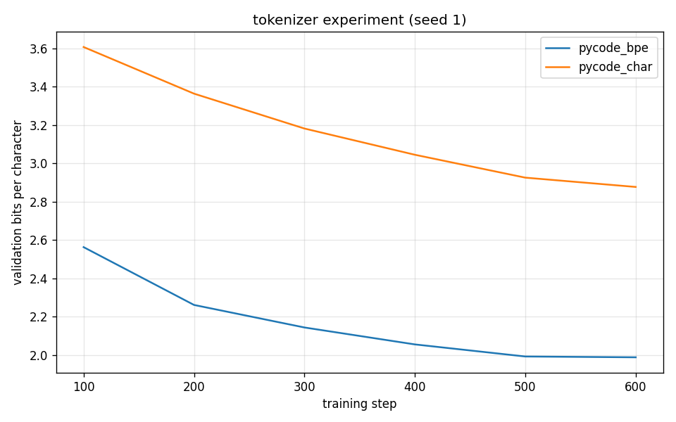
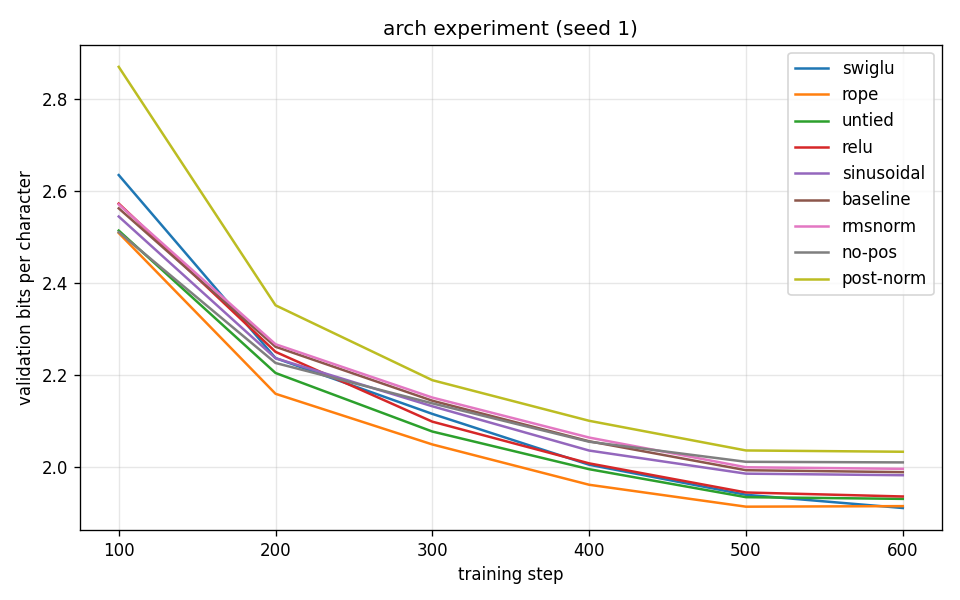

# tinyformer

[](https://github.com/sweeney-007/tinyformer/actions/workflows/tests.yml)
[](https://colab.research.google.com/github/sweeney-007/tinyformer/blob/main/notebooks/train_colab.ipynb)

**A GPT-style transformer and a byte-level BPE tokenizer, built from scratch
in Python and raw PyTorch, plus a small lab for controlled experiments on
what each part contributes.**

No Hugging Face, no `tiktoken`, no `nn.Transformer`. Attention, masking,
normalization, positional encodings, the tokenizer and sampling are all
written out by hand in about 1,200 lines of commented code, scripts included.

```
text ─► BPE tokenizer ─► token ids ─► [embedding + position]
                                          │
                              ┌───────────▼───────────┐
                              │  N × transformer block │  norm → causal attention → +
                              │                        │  norm → MLP → +
                              └───────────┬───────────┘
                                          ▼
                              norm → linear → next-token probabilities
```

## What's inside

| File | What it does |
|---|---|
| [`tinyformer/tokenizer.py`](tinyformer/tokenizer.py) | Byte-level BPE (GPT-2 style) with fast incremental training, a character tokenizer baseline, JSON save/load |
| [`tinyformer/model.py`](tinyformer/model.py) | Decoder-only transformer with swappable parts: learned / sinusoidal / RoPE / no positions, LayerNorm / RMSNorm, pre / post norm, GELU / ReLU / SwiGLU, tied / untied output |
| [`prepare.py`](prepare.py) | Trains a tokenizer and encodes a dataset |
| [`train.py`](train.py) | AdamW, warmup + cosine schedule, gradient clipping, mixed precision on CUDA, checkpoints, bits-per-character logging |
| [`sample.py`](sample.py) | Text generation with temperature, top-k and top-p, single prompt or interactive |
| [`experiments.py`](experiments.py) | Runs controlled comparisons across seeds and writes a results table and chart |
| [`tests/`](tests/) | 24 tests, e.g. the causal mask hides the future, the fast BPE trainer matches the textbook algorithm, RoPE depends only on relative position |

## Quickstart

Works on a laptop CPU, an Apple or AMD Mac GPU (MPS), or an NVIDIA GPU.

```bash
git clone https://github.com/sweeney-007/tinyformer.git && cd tinyformer
python3 -m venv .venv && source .venv/bin/activate
pip install -r requirements.txt
python -m pytest -q
```

Train on Python source code (built from your local Python install, no download needed):

```bash
python prepare.py --dataset python-stdlib --out data/pycode_bpe --vocab-size 2048
python train.py --data data/pycode_bpe --out out --preset tiny --max-iters 2000
python sample.py --out out --prompt "def " --max-new-tokens 200
```

Or Shakespeare:

```bash
python prepare.py --dataset shakespeare
python train.py --data data/shakespeare --preset tiny
python sample.py --prompt "ROMEO:"
```

No GPU? Use the [Colab notebook](notebooks/train_colab.ipynb) (free T4).

## Experiments

Every comparison changes **one thing** and measures **validation bits per
character**. Unlike per-token loss, this metric can be compared across
different tokenizers.

```bash
python prepare.py --input data/pycode_bpe/input.txt --out data/pycode_char --tokenizer char
python experiments.py --suite tokenizer --data data/pycode_bpe data/pycode_char --iters 2000 --seeds 1 2 3
python experiments.py --suite arch --data data/pycode_bpe --iters 2000 --seeds 1 2 3
```

### First results (Python code completion, Intel iMac GPU)

`tiny` preset (~1M parameters), 600 steps (≈2.5 minutes per run), 3 MB of
Python standard-library code. Seed-to-seed noise on the baseline is
**±0.013 bits/char** (3 seeds), so treat differences under ~0.03 as a tie.

**Tokenizer:** BPE beats characters by a wide margin, **1.99 vs 2.88
bits/char**. Each BPE token covers 3.2 characters, so the same 128-token
window sees 3× more code.



**Architecture** (one change each from a GPT-2-style baseline):

| variant | val bits/char | Δ vs baseline |
|---|---|---|
| SwiGLU MLP | 1.910 | −0.078 |
| RoPE positions | 1.913 | −0.075 |
| untied output layer (+25% params) | 1.930 | −0.058 |
| ReLU MLP | 1.935 | −0.053 |
| sinusoidal positions | 1.982 | −0.007 |
| **baseline** (learned positions, LayerNorm, pre-norm, GELU) | **1.988** | — |
| RMSNorm | 1.996 | +0.007 |
| no positional encoding | 2.010 | +0.021 |
| post-norm | 2.033 | +0.044 |



What stands out:
- **SwiGLU and RoPE** (both used in Llama) give the clearest gains.
- **Post-norm** (the original 2017 design) trains slower, as the literature predicts.
- **No positional encoding** is only slightly worse. A causal model can partly
  work out positions from the mask alone.
- **A bug the experiment caught:** unscaled sinusoidal positions froze
  training at 2.88 bits/char, because the waves were ~50× larger than the
  token embeddings. Scaling them to match fixed it (1.98).

These are short, single-seed runs on a tiny model: a starting point, not a
final verdict.

Sample after 600 steps (RoPE model, prompt `    def __init__(self`):

```python
    def __init__(self, value):
        """Return a a bay to conrely the patated in the
            if the list of the sorting the unter
            -1 or dared and the number of the list of the list of
        if not None:
            if not self.int.file.append(obj)
        return os.fhat(self._file, t
```

It's not correct code yet, but after 2.5 minutes it has learned indentation,
docstrings, `self.` and `return`.

## Documentation

- [Design notes](docs/DESIGN.md): why each component is built the way it is
- [Training guide](docs/TRAINING_GUIDE.md): hardware options, datasets and problems small models are good at

## References

- Vaswani et al., 2017. *Attention Is All You Need*
- Radford et al., 2019. *Language Models are Unsupervised Multitask Learners* (GPT-2)
- Sennrich et al., 2016. *Neural Machine Translation of Rare Words with Subword Units* (BPE)
- Su et al., 2021. *RoFormer: Enhanced Transformer with Rotary Position Embedding*
- Shazeer, 2020. *GLU Variants Improve Transformer* (SwiGLU)
- Zhang & Sennrich, 2019. *Root Mean Square Layer Normalization*
- Xiong et al., 2020. *On Layer Normalization in the Transformer Architecture* (pre vs post norm)
- Andrej Karpathy's nanoGPT and minbpe, which inspired the project's scope

## License

MIT
